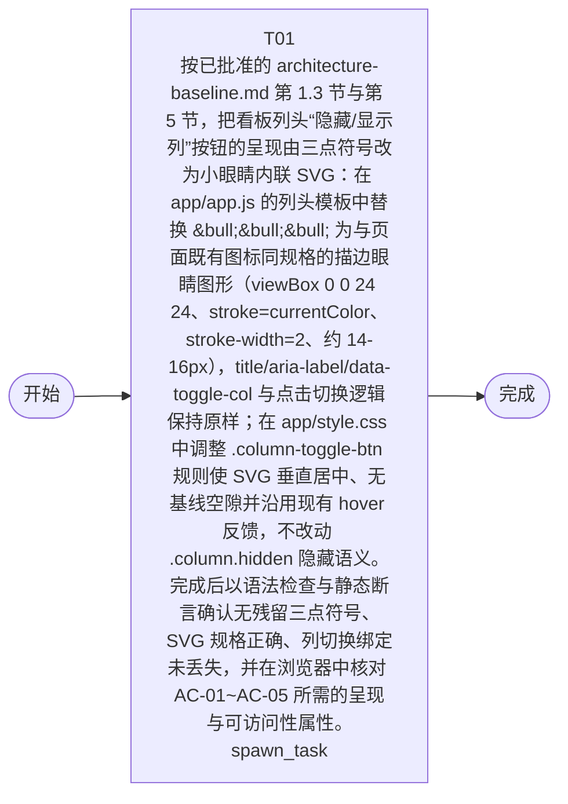

# 开发任务编排

<!-- sourcePlanId: plan:fd2e0413-ed4a-4466-a863-967b0daeaef1 | rendererVersion: 3 -->

## 摘要

- Schema 版本: 1
- 需求来源: `sha256:fce0d6369765969906fb918f378ea7f8f5ded2c97bb66483b6369197409b79f4`
- 设计来源: `sha256:1951d4ba3021ef026b65f19a001ea4a61e65f5e758da42c2ced2fde109e2be78`
- 任务数: 1

## 任务

| 任务 | 目标 | 执行模式 | 依赖 | 能力 |
| --- | --- | --- | --- | --- |
| T01 | 按已批准的 architecture-baseline.md 第 1.3 节与第 5 节，把看板列头“隐藏/显示列”按钮的呈现由三点符号改为小眼睛内联 SVG：在 app/app.js 的列头模板中替换 &bull;&bull;&bull; 为与页面既有图标同规格的描边眼睛图形（viewBox 0 0 24 24、stroke=currentColor、stroke-width=2、约 14-16px），title/aria-label/data-toggle-col 与点击切换逻辑保持原样；在 app/style.css 中调整 .column-toggle-btn 规则使 SVG 垂直居中、无基线空隙并沿用现有 hover 反馈，不改动 .column.hidden 隐藏语义。完成后以语法检查与静态断言确认无残留三点符号、SVG 规格正确、列切换绑定未丢失，并在浏览器中核对 AC-01~AC-05 所需的呈现与可访问性属性。 | spawn_task | - | engineering.implementation |

## 依赖执行图

### 文本备选

- T01 (根任务)

## 并行分组

- 层级 0: T01

## 任务契约

### T01

**目标:** 按已批准的 architecture-baseline.md 第 1.3 节与第 5 节，把看板列头“隐藏/显示列”按钮的呈现由三点符号改为小眼睛内联 SVG：在 app/app.js 的列头模板中替换 &bull;&bull;&bull; 为与页面既有图标同规格的描边眼睛图形（viewBox 0 0 24 24、stroke=currentColor、stroke-width=2、约 14-16px），title/aria-label/data-toggle-col 与点击切换逻辑保持原样；在 app/style.css 中调整 .column-toggle-btn 规则使 SVG 垂直居中、无基线空隙并沿用现有 hover 反馈，不改动 .column.hidden 隐藏语义。完成后以语法检查与静态断言确认无残留三点符号、SVG 规格正确、列切换绑定未丢失，并在浏览器中核对 AC-01~AC-05 所需的呈现与可访问性属性。

**角色:** general-app-development-expert  \  **失败策略:** block

**需求**

- AC-01
- AC-02
- AC-03
- AC-04
- AC-05

**输入**

- docs/wi-t1000001/requirements.md [sha256:fce0d6369765969906fb918f378ea7f8f5ded2c97bb66483b6369197409b79f4]
- docs/wi-t1000001/architecture-baseline.md [sha256:1951d4ba3021ef026b65f19a001ea4a61e65f5e758da42c2ced2fde109e2be78]

**产物**

- （无）

**可写范围**

- app/app.js
- app/style.css

**完整写入路径**

- app/app.js
- app/style.css

**验证命令**

- node --check app/app.js
- node -e "const fs=require('fs');const a=fs.readFileSync('app/app.js','utf8');const s=fs.readFileSync('app/style.css','utf8');if(a.includes('&bull;&bull;&bull;'))throw new Error('列头仍存在三点符号');if(!/column-toggle-btn[^>]*data-toggle-col/.test(a))throw new Error('列头切换按钮或 data-toggle-col 丢失');if(!/viewBox=\\"0 0 24 24\\"/.test(a))throw new Error('未找到同规格 SVG 图标');if(!/column-toggle-btn/.test(s))throw new Error('.column-toggle-btn 样式丢失');console.log('icon-replacement-static-check ok');"

**阻塞码**

- （无）
